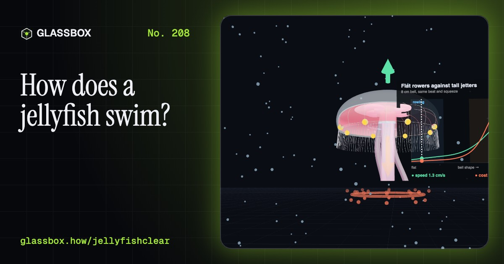
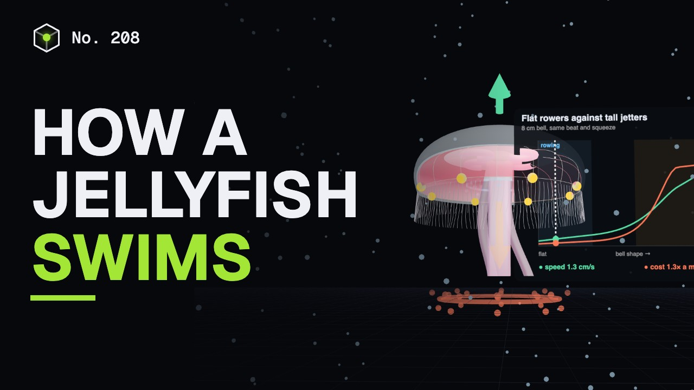
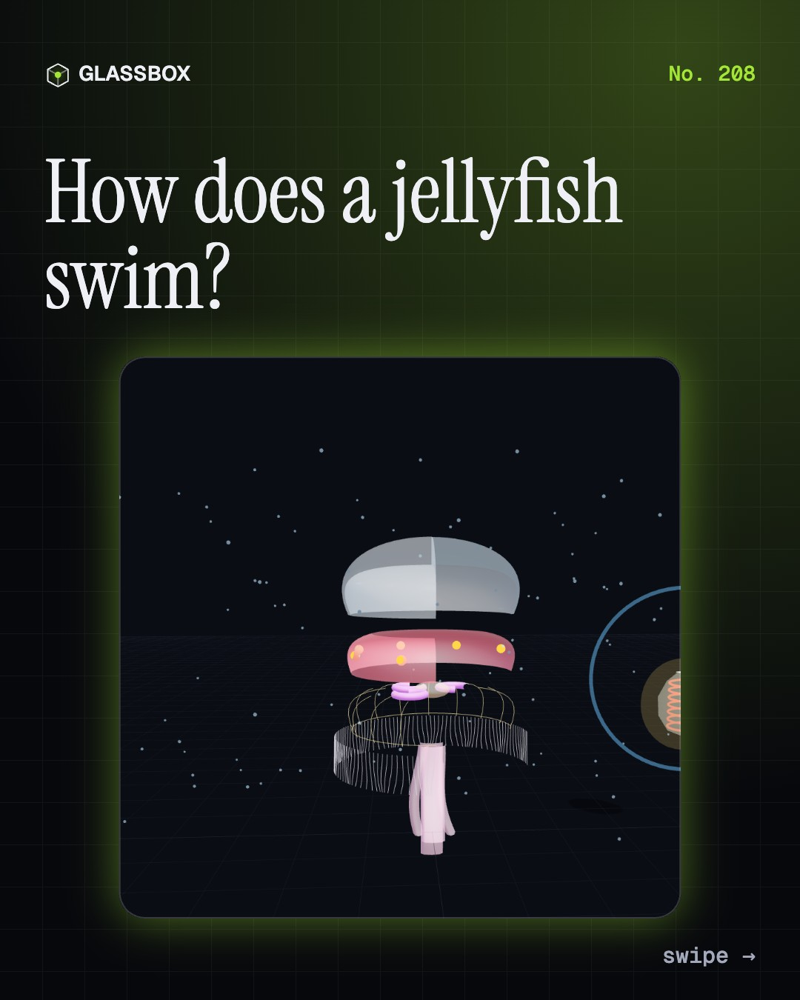
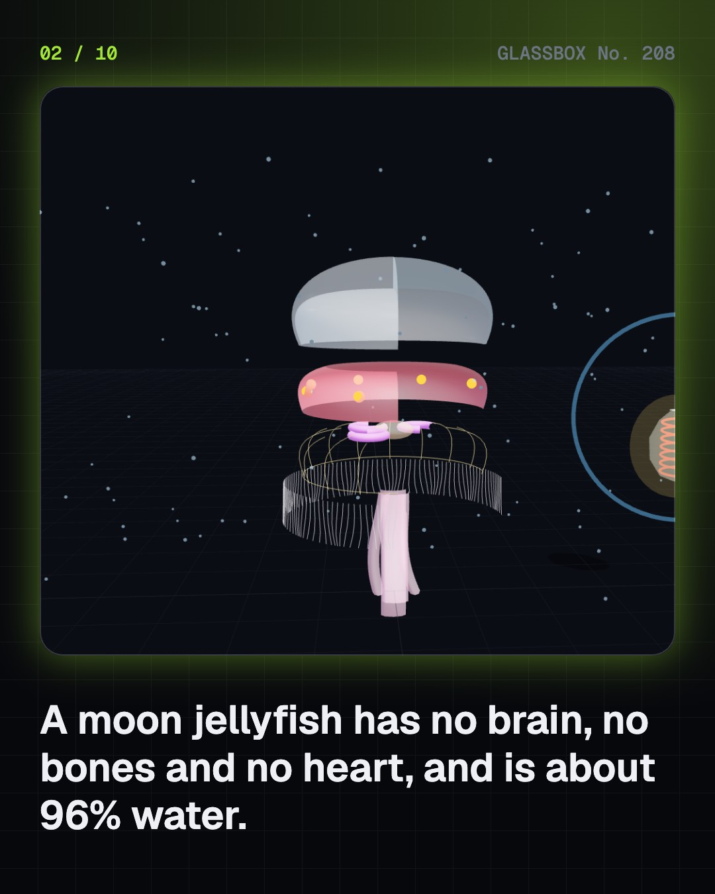
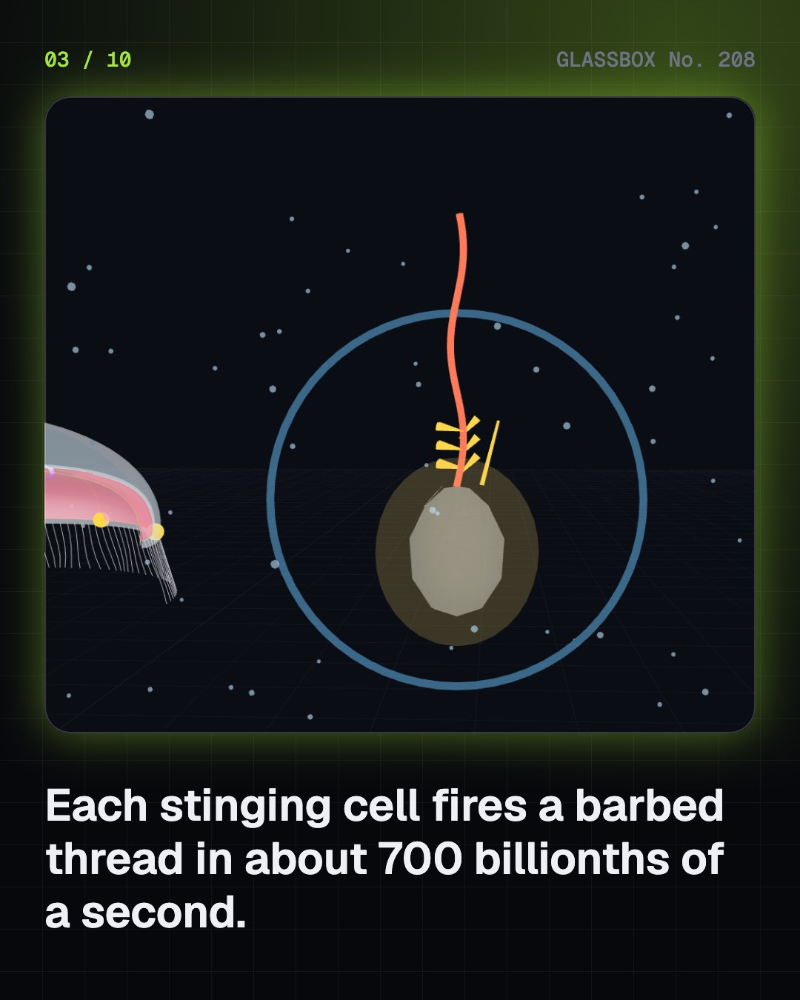
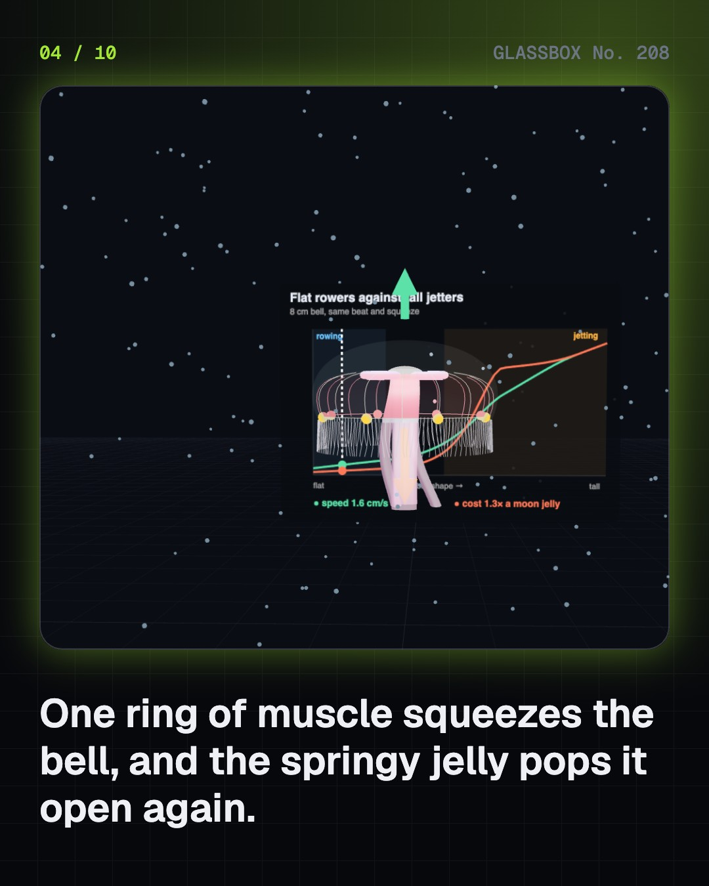

<!-- glassbox:start -->
<!-- Generated from glassbox.json by the Glassbox hub (npm run readme -- jellyfishclear). Edit glassbox.json, not this block. -->
<p align="center"><a href="https://glassbox.how/e/jellyfishclear/"></a></p>

<h1 align="center">JellyfishClear</h1>

<p align="center"><b>How does a jellyfish swim?</b><br>A jellyfish has one ring of muscle, no brain and no bones, yet it is one of the thriftiest swimmers ever measured. Watch its bell squeeze, spring back and ride a ring of its own swirling water.</p>

<p align="center"><a href="https://glassbox.how/jellyfishclear/"><b>▶ Play with it</b></a> &nbsp;·&nbsp; <a href="https://glassbox.how/e/jellyfishclear/">Read the 60-second explainer</a> &nbsp;·&nbsp; <a href="https://glassbox.how/jellyfishclear/glassbox/reel.mp4">Watch the 40-second video</a></p>

<p align="center">
  <a href="https://glassbox.how/e/jellyfishclear/"></a>
  <a href="https://glassbox.how/e/jellyfishclear/"></a>
  <a href="LICENSE"></a>
  <a href="LICENSE-CONTENT.md"></a>
  <a href="#privacy"></a>
</p>

## In 60 seconds

1. **A bell of jelly.** A moon jellyfish is about 96% water. Its bell is a springy jelly called mesoglea with one thin ring of swimming muscle underneath. A nerve net replaces a brain, eight rhopalia at the rim sense light and gravity, and stinging cells fire barbed threads in under a millionth of a second.
2. **Squeeze, spring back, glide.** The muscle squeezes the bell and pushes water out; the springy jelly pops it open again for free. Tall jellies jet fast but at a high energy cost. Flat moon jellies row: a second swirl under the refilling bell gives a free push, so they go about 30% further per beat and spend less energy to travel than other animals measured.
3. **Drifting, balancing, steering.** Jellies swim a few centimetres a second, so currents carry them: they are plankton. Balance crystals in the rhopalia tell down from up, and the rhopalia start every beat. Box jellyfish have 24 eyes and one kind looks up through the surface to find mangrove trees.
4. **From polyp to jellyfish.** A larva settles on a rock and becomes a polyp that clones itself, then splits into a stack of discs that pop off as eight-armed baby jellies. That is how blooms appear so suddenly. The 'immortal' Turritopsis can turn back into a polyp under stress, but most still die.
5. **Blooms, stings and dinner.** CMFRI has counted swarms of up to 800 jellies in one net off Kerala, and swarms have shut the Kalpakkam power plant's cooling water. Whether blooms are rising worldwide is debated. India now exports jellyfish to East Asia. First aid differs by kind: vinegar for box jellyfish, never for bluebottles.
6. **How we found out.** Romanes cut the rim off a jelly in the 1870s and the bell stopped. Shimomura found the glowing protein GFP in a jelly in 1961, which won the 2008 Nobel Prize. Jellies flew in space in 1991, and in 2012 engineers built a jelly robot from heart-muscle cells.

## Words worth knowing

| Term | Meaning |
|---|---|
| **Mesoglea** | The springy, mostly-water jelly that forms a jellyfish's bell and springs it back open after each squeeze. |
| **Coronal muscle** | The single ring of swimming muscle on the underside of the bell. |
| **Rhopalium** | A small sense club at the bell's rim with a balance crystal and light sensors; it also paces the beat. |
| **Nematocyst** | The capsule in a stinging cell, holding a coiled barbed thread that fires out when triggered. |
| **Vortex ring** | A doughnut of spinning water thrown off by each pulse of the bell. |
| **Passive energy recapture** | The free extra push a flat jelly gets from the stopping vortex under its bell as it refills. |
| **Cost of transport** | The energy needed to move one kilogram of animal one metre; moon jellies' is among the lowest measured. |
| **Strobilation** | A polyp splitting into a stack of discs that are released as baby jellyfish (ephyrae). |
| **Bloom** | A sudden, very large number of jellyfish in one place. |

## A short history

**From Linnaeus naming the moon jelly to Romanes snipping off its rim, a Nobel-winning glow, jellies in orbit, robot medusae and India's jellyfish season.**

- **1875** · Cut the rim, stop the beat (George John Romanes, London)
- **1961** · Thousands of glowing jellies (Osamu Shimomura and Frank Johnson, Friday Harbor, Washington)
- **1991** · Jellyfish in orbit (Dorothy Spangenberg and NASA, Space Shuttle Columbia (STS-40), Spacelab Life Sciences 1)
- **1996** · Jellyfish shut a power plant (Madras Atomic Power Station, Kalpakkam, Tamil Nadu)
- **2008** · A Nobel Prize for a jellyfish protein (Osamu Shimomura, Martin Chalfie and Roger Tsien, Stockholm)
- **2012** · The Medusoid (Janna Nawroth, John Dabiri, Kevin Kit Parker and colleagues, Caltech and Harvard)
- **2013** · The thriftiest swimmer (Brad Gemmell, John Costello, Sean Colin, John Dabiri and colleagues, Laboratory and field studies, USA)

The full story, with 27 moments, charts, people and 41 sources: [glassbox.how/e/jellyfishclear/history](https://glassbox.how/e/jellyfishclear/history/). The data lives in [`history.json`](history.json).

## Video and slides

Made with the Glassbox studio from this box's storyboard (`window.glassbox.director`). Free to reuse under CC BY 4.0.

<a href="https://glassbox.how/jellyfishclear/glassbox/video.mp4"></a>

<p><a href="glassbox/slide-1.jpg"></a> <a href="glassbox/slide-2.jpg"></a> <a href="glassbox/slide-3.jpg"></a> <a href="glassbox/slide-4.jpg"></a></p>

| File | What | Size |
|---|---|---|
| [`glassbox/reel.mp4`](https://glassbox.how/jellyfishclear/glassbox/reel.mp4) | Reel / Short, with captions and soundtrack | 1080×1920 |
| [`glassbox/video.mp4`](https://glassbox.how/jellyfishclear/glassbox/video.mp4) | YouTube video, with captions and soundtrack | 1920×1080 |
| `glassbox/slide-1…10.jpg` | Instagram carousel | 1080×1350 |
| `glassbox/thumb.jpg` | YouTube thumbnail | 1280×720 |
| `glassbox/cover.jpg` | Share card and repo social preview | 1200×630 |
| [`glassbox/history-reel.mp4`](https://glassbox.how/jellyfishclear/glassbox/history-reel.mp4) | “History in 10 moments” Reel / Short | 1080×1920 |
| `glassbox/history-slide-*.jpg` | History carousel | 1080×1350 |
| `glassbox/post.json` | Post copy and schedule used by the publish kit | |

## Privacy

This box has no accounts and no ads, and it ships its own fonts and libraries. When you run it yourself it sends nothing anywhere. On glassbox.how, the site's `/bar.js` also loads Glassbox's analytics: **Google Analytics** to count visits (it asks first in the EU, UK and Switzerland, and stays off when your browser sends Global Privacy Control or Do Not Track) and **ClickTrust** to detect bots.

It remembers a few things **in your own browser only**, and never sends them anywhere:

| Browser storage key | What it holds |
|---|---|
| `jellyfishclear.v1` | Which chapters you have opened, your best quiz scores, and sound on or off. |

Exactly what each one sees is at [glassbox.how/privacy](https://glassbox.how/privacy/).

## Licences

- **Code:** [MIT](LICENSE). Use it, change it, ship it.
- **Explanations, text, images and videos** (`glassbox.json`, `glassbox/`): [CC BY 4.0](LICENSE-CONTENT.md). Credit “Glassbox, glassbox.how/e/jellyfishclear”.
- **Third-party parts** keep their own licences: [three.js](https://threejs.org) (MIT), [Geist, Instrument Serif](https://openfontlicense.org) (SIL OFL 1.1).
- The Glassbox name and logo aren't covered by either licence. See the [terms](https://glassbox.how/terms/).

Found a mistake? [Open an issue](https://github.com/bdeeps/jellyfishclear/issues). Corrections happen in public.
<!-- glassbox:end -->

## Run it

It's plain HTML, CSS and JavaScript. No build step and no dependencies. Run locally, it contacts no other website.

```bash
python3 -m http.server 8000
```

Three.js and the fonts ship in `vendor/` and `fonts/`, so it also works offline.

Then open http://localhost:8000.

## How it's built

| File | What |
|---|---|
| `index.html`, `css/app.css` | The page and its styles |
| `js/app.js`, `js/stage.js`, `js/ui.js`, `js/kit.js` | The shared Glassbox 3D engine: chapters, 3D stage, controls, quiz, video director |
| `js/chapters/*.js` | One file per chapter: the 3D model, controls, text, key terms, quiz and video scenes |
| `js/jelly.js` | The pulsing jellyfish (bell, coronal muscle, canals, gonads, rhopalia, tentacles, oral arms) in four kinds, the pulse and swimming model, vortex rings, water specks, chart boards and layout helpers shared by the chapters |
| `glassbox.json` | Title, question, explainer beats, key terms, browser storage and credits shown on glassbox.how |
| `reel` in each chapter | The storyboard the Glassbox studio records into short videos |
| `glassbox/` | The published video, slides, thumbnail and post copy |
| `fonts/`, `vendor/three/` | Self-hosted Geist and Instrument Serif (SIL OFL 1.1) and three.js (MIT) |
